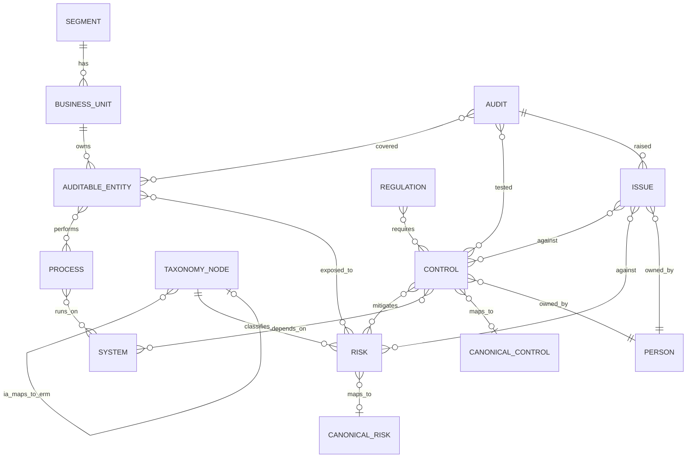

# Data model

The schema (`src/features/stores/schema.sql` and the Neo4j loader, once built) is the source of truth for fields. This file holds what the schema cannot say on its own. Drafted in the kickoff interview, 2026-11-19.

## The institution
A fictional US regional bank, about $60B in assets. Segments: Consumer Banking, Commercial Banking, Wealth Management, Treasury & Markets, Operations, Technology, Corporate functions. All names (institution, people, vendors, systems) come from fictional name lists the project controls.

## Entities and relationships

Notes:
- **Two sources.** `TAXONOMY_NODE`, `RISK` and `CONTROL` each carry `source` = `ERM` or `IA`. ERM's taxonomy is Basel-style (L1: Credit, Market, Liquidity, Operational, Compliance, Strategic, Reputational); IA's is a legacy L1-L3 that maps unevenly onto it.
- **Risk levels.** L1-L3 are taxonomy categories (a tree per source). A risk is an L4 item under exactly one L3 node of its own source's tree.
- **Controls.** ERM controls come from the RCSA; IA controls from the RCMs. Attributes: type (preventive/detective), nature (manual/automated), frequency, key flag, owner.
- **Canonical layer.** Output of reconciliation. ERM's taxonomy is the common framework: IA taxonomy nodes map onto ERM nodes, and source risks and controls map to canonical items. Matches below the confidence threshold sit in a review queue instead.
- **Issue sources.** IA, Regulator (MRA/MRIA), self-identified, 2nd line. Only IA issues link to an audit.
- **IA-to-ERM taxonomy mapping** (E2 child a, 011; `src/features/reconciliation/taxonomy_map.py`). `ia_maps_to_erm` has one row per IA node, with columns `ia_node_id`, `erm_node_id` (or `unmapped`), `score` and `basis`. The allowed levels match the answer key's: IA L1 -> ERM L1, IA L2 -> ERM L1 or L2, IA L3 -> ERM L2 or L3. Method:
  - Each IA risk votes for its most similar ERM risk (word plus character TF-IDF, plus a bonus for a shared exposed entity or business unit).
  - An IA node maps to the deepest allowed ERM node holding at least half its subtree's votes (`basis` = `vote`; `score` is that share), or is `unmapped`.
  - A node with no IA risks under it is `unmapped` with `basis` = `no_risks` (12-13 per seed). No risk's placement depends on those nodes.

  Measured accuracy on nodes holding risks:

  | Seed | Accuracy | Per level | Falsely `unmapped` |
  |---|---|---|---|
  | 42 (AI text) | 44/62 = 0.71 | L1 6/9, L2 14/20, L3 24/33 | 2 |
  | 7 (templated) | 0.62 | | 7 |
  | 1 (templated) | 0.65 | | 9 |

  Node names alone score 0.33. Known limit: IA nodes that are truly unmapped but hold risks are not detected, because their risks truly sit in one ERM node; only the truly unmapped `no_risks` nodes come out `unmapped`.
- **Pair matching** (E2 child b, 012; `src/features/reconciliation/features.py`, `train.py`, `match.py`). Every candidate pair of three kinds is scored:
  - cross-source risks (ERM x IA, 27,000 at seed 42);
  - within-ERM risk duplicates (16,110);
  - cross-source controls (118,105).

  *Features* are text and structure. Word and character TF-IDF cosines are each turned into a **tail score**, `-log10(1 - p + 1/n)` of their percentile within the bank, so they are scale-free across text styles. The other features are candidate rank, shared exposed entity or business unit, child a's taxonomy mapping, equal rating, and for controls: links to scored risk pairs, equal type, nature and frequency, a shared system, and the citation cue.

  *Weights* come from one logistic model per kind (class-weighted, converged at `tol=1e-10`), learned once by `train.py` on a separate **training bank** (seed 7, templated text, built in a temporary directory). They are committed as `src/features/reconciliation/weights.json` with a fingerprint of the training bank and the feature's source. The build never trains, and only `train.py` reads an answer key: the training bank's.

  *Thresholds* are set on the training scores, at tie-group boundaries:
  - auto-accept: the lowest score whose at-or-above set has at least 95% precision;
  - review floor: the highest score holding at least 99% of the true pairs.

  ERM duplicates are **review-only** (owner decision, 012): 13 true pairs per bank cannot support a 95% precision estimate, so they have a floor but no auto-accept.

  Measured by the built module, with the weights applied unchanged:

  | Kind | Seed 42 (AI text, published) | Seed 1 (templated) |
  |---|---|---|
  | Risks | 38 auto-accepted (precision 0.95), 122 queued, 2 of 103 missed | 42 (0.93), 131 queued, 0 missed |
  | Controls | 68 (1.00), 341 queued, 5 of 245 missed | 95 (0.98), 318 queued, 2 missed |
  | ERM duplicates | 14 queued, 1 of 13 missed | 15 queued, 0 missed |

  *Why tail scores:*
  - With raw cosines, the templated-trained duplicate model missed 10 of 13 AI-text duplicates: templated duplicates are near-copies, AI ones paraphrases.
  - Plain percentiles under class weighting bunched the duplicate scores within 1e-5.
  - Unweighted models about doubled the control queue.
- **Canonical layer** (E2 child c, 013; `src/features/reconciliation/canonical.py`). `python -m akg build` generates and then reconciles; `build --no-reconcile` generates only and removes any stale output; `python -m akg reconcile --out <dir>` reconciles an existing build. Reconciliation writes `<out>/reconciled/`:
  - `canonical_risk.csv` (`canonical_risk_id`, `erm_l3_node_id`, `placement`)
  - `canonical_control.csv` (`canonical_control_id`)
  - `risk_maps_to_canonical.csv` and `control_maps_to_canonical.csv` (`source`, item ID, canonical ID, `logit`)
  - `ia_maps_to_erm.csv` (child a's rows)
  - `review_queue.csv` (`kind`, `item_a`, `item_b`, `logit`, `reason`, `drivers`)

  Scores are logits (log-odds) with 6 decimals; bands and merge order use the unrounded value. Canonical IDs (`CR-`, `CC-`) are numbered in order of each item's lowest member ID.

  *Assignment:*
  - Accepted cross-source pairs merge in order of logit (then ERM ID, then IA ID).
  - A canonical risk holds at most one ERM risk and one IA risk.
  - A canonical control holds at most one ERM control, and each IA control joins its best accepted one.
  - A losing accepted pair is queued with reason `conflict`.
  - Review-band pairs and every duplicate pair at or above its floor are queued with reason `review_band`.
  - `drivers` names the three features with the largest signed contribution.
  - Everything unmerged is a singleton.

  *Placement* gives every canonical risk an ERM L3 node: the ERM risk's own node (`erm`, `matched`), else the IA node's mapped L3 target (`mapped`), else the node of the most similar ERM risk within the mapped subtree, or among all ERM risks if none (`nearest`).

  Measured by the built module on seed 42:
  - Risks: 33 pairs merged, precision 1.00, recall 0.32; 5 conflicts queued, 3 of them true (an IA risk matching both an ERM risk and its duplicate).
  - Controls: 68 pairs merged, precision 1.00, recall 0.28.
  - Queue: 122 risk, 14 duplicate and 341 control review-band rows, plus the 5 conflicts (482 rows).
  - Result: 297 canonical risks and 626 canonical controls.
  - IA placement: 130/150 (matched 33/33, mapped 89/103, nearest 8/14).

  `tests/golden/checksums_reconciled.sha256` freezes this output (INV-7). Regenerate it with `.venv\Scripts\python -m tests.reconciliation.golden`.
- **Answer key.** The generator records which source items are true duplicates and the true taxonomy mapping, in a separate folder. It is used only for scoring.
- **Published layout** (005). ERM and IA are separate systems, so taxonomy nodes, risks and controls are published one file per source (`risk_erm.csv`, `risk_ia.csv`, ...), as is every relationship touching them. Audits test IA controls only. The column-level data dictionary is `src/features/generator/README.md`.
- **Documents (M2).** Workpapers, RCMs and reports, linked to audits, controls and issues. Not in M1.

- **Risk populations at full size** (007). A risk is an instance of a *theme* (a kind of risk, such as fraudulent wire transfers) applied to one auditable entity; 56 themes give 232 instances. The generator picks which instances appear in ERM, in IA, in both (a true match) or twice in ERM (a within-ERM duplicate). IA names its audit area (the entity) in its text; ERM describes the context in its own business terms, and its context phrase never uses a distinctive word of the entity's name; a few ERM risks still name an entity when that name is the risk's own subject (for example Fair Lending, Tax). ERM entries vary in sentence frame and wording by team. A duplicate is a copy another team edited: its AI text is rewritten from its original's AI text, keeping the impact sentence nearly word for word and putting the cause and event in that team's own words (010). Inherent ratings vary by instance around the theme's rating: High 15-35%, Medium 40-60%, Low 15-35% per source.
- **Exposure differs by source** (007). IA links a risk to its specific auditable entity. ERM links it to every entity of the owning business unit, and 10-20% of ERM exposure links point to an entity of another business unit in the same segment (a stale register).
- **Risk answer key** (`answer_key/risk_clusters.csv`: `source`, `risk_id`, `cluster_id`, `true_erm_node_id`). Every risk appears once; a cluster with both sources is a true match; two ERM risks in one cluster are a duplicate; `none` means unmatched. Every risk, ERM or IA, carries its true ERM L3 node. An IA risk is *misfiled* when its true ERM node is not under its IA node's mapped ERM target, including when that IA node is unmapped (10-20% of IA risks).
- **Control populations at full size** (008). Each risk instance has its theme's *specific* control in each source holding it. *Generic* controls come from eight kinds (policy and procedures, management oversight, exception monitoring, reconciliation, segregation of duties, staff training, access restriction, key risk indicator). ERM records generic controls bank-wide, one per theme and kind, mitigating every ERM risk of the theme; IA records them per risk instance, taking ERM's kinds for the theme with probability 0.6 (the overlap dial) and otherwise from the same weighted mix. ERM and IA word subjects and kind labels differently; IA's detailed text cites the enterprise control it implements, with IA's own word for the kind and ERM's subject phrase ("enterprise oversight standard on outgoing wire transfers"). This is a deliberate, realistic cue (owner decision, 2026-11-20): real IA work papers cite enterprise policies by name. Measured on seed 42 with the AI text (010; `tests/golden/cue_figures.json`): quoting ERM's whole title inside IA text pairs generic controls at F1 0.45 (templated 0.30); matching ERM's subject phrase plus control type and nature reaches F1 0.64, and adding a hand-made map from IA's citation phrase to ERM's kind label reaches 0.74 (templated 0.78). E2 should report how much of its control accuracy comes from this cue. Owners always differ within a match; IA records a neighbouring frequency for about 22% of its controls; control type always agrees. ERM names systems for about half its controls; only specific, reconciliation and access-restriction controls depend on systems.
- **Control answer key** (`answer_key/control_clusters.csv`: `source`, `control_id`, `cluster_id`). A cluster is one ERM control plus every IA control of the same risk instance (specific) or the same theme and kind (generic); no cluster holds two ERM controls. Orphan controls (3-6% per source) mitigate no risk, sit in no cluster and have no counterpart in the other source (the build refuses one that does). Note for E2: "mitigates no risk" always predicts "unmatched"; that is a small, honest structural give-away, not matcher skill. Only cross-source pairs (and ERM duplicates) are scored; several IA controls documenting one enterprise control share wording by design.
- **Scenarios** (`answer_key/scenarios.csv`: `scenario`, `item_id`). Child d writes `shared_system`: the 3 systems whose dependent controls reach the most auditable entities through control -> mitigates -> risk -> exposed entity, as the union over both sources (ties by system name; the third must beat the fourth outright). Child e appends its scenarios.
- **Audit plan at full size** (009). About 75 audits, 25 a year (2023-2025), each covering 1-3 auditable entities chosen by risk (entities with High IA risks are sampled more often); about 10% of entities with IA risk sit outside the plan, and random sampling leaves others unaudited (10-30% in all). An audit scopes in about two thirds of each covered entity's IA risks and tests every IA control (specific and generic) mitigating them; a risk counts as tested when any of its IA controls was tested.
- **Issues at full size** (009). About 250: IA 50% (raised by audits, against a tested control and the risk it mitigates, opened up to 20 days after the audit ends), regulator 15%, self-identified 15%, 2nd line 20% (against an ERM control and the ERM risk it mitigates). Titles use four phrasings per source on the source's own subject wording, never the control's title; descriptions open four ways around the control's finding. With templated text the finding sentence recurred across issues on one control: stripping the four fixed openings and grouping by the rest put every planted repeat group in one bucket (recall 1.0, pair precision 0.36). The AI text words each finding afresh, so that text cue is gone (recall 0.00, pair precision 0.00 on seed 42, 010); repeat findings are found through the published issue-to-control links and dates instead. An IA issue opens within its audit's year.
- **Planted scenarios** (009, appended to `answer_key/scenarios.csv` after 008's `shared_system`): `repeat_finding:<n>` lists every IA issue against one IA control that failed in at least two years (pairwise different titles); the listed groups are all such controls (no unlisted repeats); `untested_high_risk` lists exactly the High-rated IA risks none of whose IA controls any audit tested; `rising_category` names the ERM L1 node whose regulator, self-identified and 2nd-line issues (classified through the published ERM taxonomy, no answer key) rise at least 50% from 2023 to 2025 from at least 8, while total issues stay within 15%. IA issues are not counted for the rising category (E3 round 7). Every regulation reaches at least one business unit at full size.
- **Seeds.** Scenario targets (at least 8 untested High risks, a 10-30% coverage gap, the rising category) are guaranteed and tested for seed 42, the published dataset. Other seeds build valid data but may fall short of a target (009 review: seed 99 had 4 untested High risks, seed 13 a 37% gap).
- **Stale coverage** (for E3 round 2): a control is stale when never tested in the window, or last tested more than 24 months before window end.
- **Default size.** `python -m akg build` builds full size; `--size sample` builds the sample pack's slice. Both sizes default to the committed AI text; `--text templated` gives the templated drafts, and `--count` overrides at full size need it (their new items have no AI text).
- **Full-size AI text** (010). All 1,274 full-size descriptions were written once with claude-opus-5-5 through the Message Batches API and committed in `src/features/generator/text/ai_text_full.jsonl` (the sample keeps `ai_text.jsonl`). The build never calls an API. Each entry's input hash includes the full prompt version, so a changed draft or prompt fails the build naming the key. The prompt lists every system name and allowed term, so **editing those name lists makes all full-size text stale** (a paid regeneration). Each ERM duplicate's entry also records a hash of its original's text and of its note, so changing either makes that duplicate stale. Every entry passes the AI-text rules: no added systems, ERM controls one sentence of at most 30 words, issue openings kept, no real institution names, and no capitalized word outside the name lists, the allow-list, the bank's own published names, the item's own draft, months and ID/IDs. One entry failed twice and holds an owner-approved hand edit: `control_ia:cmp_handling@mortgage-servicing#sod`. Actual cost: $5.26 over eight batches (`research/r2-synthetic-text-realism/cost_log.md`), within the owner's $10 budget.
- **Difficulty on AI text** (010). Measured on seed 42, all recorded in `tests/golden/cue_figures.json`. Risk TF-IDF F1 is 0.47. ERM duplicate F1 is 0.60, and duplicates' median cosine of 0.56 stands clear of same-theme non-duplicate siblings at 0.31; the test requires a gap of at least 0.15, guarding L-007's near-copy failure directly. Control TF-IDF F1 is 0.28, against a chance level of 0.004 (predicting every pair). Its floor was lowered from 0.40 to 0.25 by owner decision, knowingly overriding L-007: real records written by different teams share little wording, so a word-overlap baseline should struggle and E2's structural signals carry more of the work. Every ceiling and leakage check is unchanged; the entity-mention ceilings guard against ERM text using an entity's distinctive words.
Target sizes: ERM about 180 risks and 300 controls; IA about 150 risks and 400 controls; about 60% overlap between the populations. About 80 auditable entities, 75 audits over 3 years, 250 issues, 120 people, 30 systems, 15 regulations. Built-in messiness: duplicates inside ERM, controls described at different levels of detail, orphan controls that mitigate no risk.

## Invariants
Rules that must always hold. Each has an ID and a test that enforces it (tests named once the code exists).

| ID | Invariant | Enforced by |
|---|---|---|
| INV-1 | Each taxonomy is a strict tree; every L4 risk sits under exactly one L3 node of its own source's taxonomy. | Taxonomy part: `generator.test_invariants.InvariantTests.test_ac2_inv1_taxonomies_are_strict_trees`; risk part: `generator.test_invariants.InvariantTests.test_ac2_inv1_each_risk_under_one_l3_of_its_source` |
| INV-2 | Every auditable entity belongs to exactly one business unit. | `generator.test_invariants.InvariantTests.test_ac3_inv2_each_entity_has_exactly_one_owner` |
| INV-3 | Each source risk or control maps to exactly one canonical item (a singleton when unmatched). An ERM-IA pair merges only at or above its kind's auto-accept threshold; uncertain pairs go to the review queue, so nothing below the confidence threshold merges silently. | `reconciliation.test_canonical.CanonicalTests.test_ac3_inv3_whole_output` |
| INV-4 | Every IA issue links to exactly one audit; every issue links to at least one control or risk, and has exactly one owner and one source. | `generator.test_invariants.InvariantTests.test_ac2_inv4_inv5_issue_links_and_dates` |
| INV-5 | Dates are consistent: closure never before open; audits within the 3-year window; an issue never before the audit that raised it. | `generator.test_invariants.InvariantTests.test_ac2_inv4_inv5_issue_links_and_dates` |
| INV-6 | The reconciliation pipeline never reads the published bank's answer key; only the scoring step does. The training script alone may read the training bank's (seed 7) answer key, to learn the committed weights. | `reconciliation.test_canonical.CanonicalTests.test_ac4_inv6_reconciled_output_ignores_the_answer_key` |
| INV-7 | The same seed produces byte-identical output. | Sample: `generator.test_determinism.DeterminismTests.test_ac3_inv7_output_matches_golden_checksums`; full: `generator.test_determinism.DeterminismTests.test_ac5_full_build_matches_full_golden`; reconciled: `reconciliation.test_canonical.CanonicalTests.test_ac5_reconciled_output_matches_its_golden` |
| INV-8 | SQLite and Neo4j hold the same facts (row counts reconcile with node and edge counts). | TBD (E3) |
| INV-9 | Institution, people, vendor and system names come only from the project's fictional name lists. | `generator.test_names.NameTests.test_ac4_inv9_names_from_lists_and_no_denied_name_anywhere` |
| INV-10 | No relationship crosses sources: ERM controls mitigate ERM risks, IA controls IA risks, each taxonomy is its own tree, and so on. ERM-IA links exist only in the answer key (truth) and the canonical layer (E2 output). | `generator.test_referential.ReferentialTests.test_ac12_relationship_ids_exist_and_never_cross_sources` |

## Decisions
- **ERM's taxonomy is the common framework** (kickoff, 2026-11-19): it is what most banks actually do, and it is easier to defend than inventing a new one.
- **Everything is synthetic, public and regenerable**, so there are no retention or deletion concerns. The answer key is published too, for transparency.

## Open data questions
- Matching method for reconciliation (research R1).
- Templated vs AI-written descriptions (research R2).
