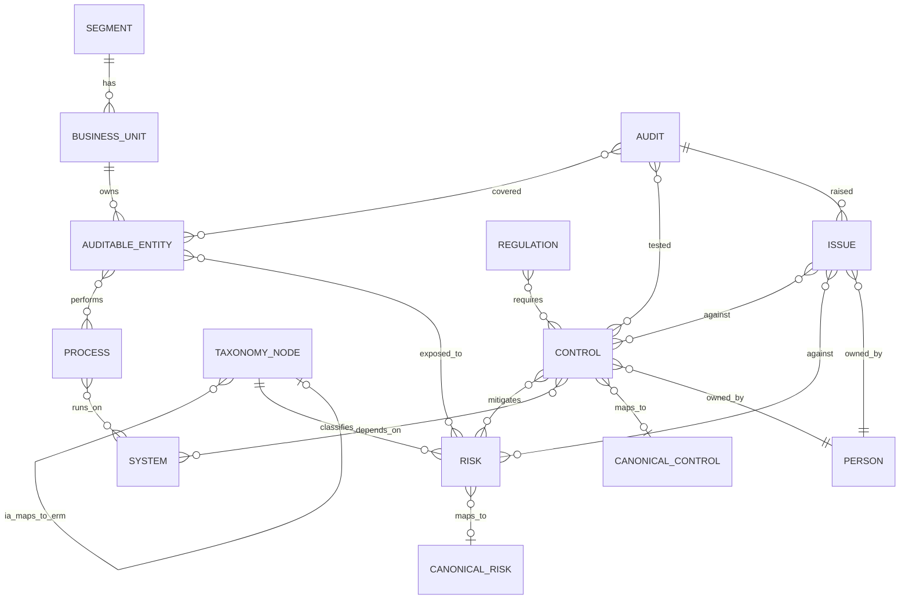

# Data model

The schema (`src/features/stores/schema.sql` and the Neo4j loader, once built) is the source of truth for fields. This file holds what the schema cannot say on its own. Drafted in the kickoff interview, 2026-11-19.

## The institution
A fictional US regional bank, about $60B in assets. Segments: Consumer Banking, Commercial Banking, Wealth Management, Treasury & Markets, Operations, Technology, Corporate functions. All names (institution, people, vendors, systems) come from fictional name lists the project controls.

## Entities and relationships

Notes:
- **Two sources.** `TAXONOMY_NODE`, `RISK` and `CONTROL` each carry `source` = `ERM` or `IA`. ERM's taxonomy is Basel-style (L1: Credit, Market, Liquidity, Operational, Compliance, Strategic, Reputational); IA's is a legacy L1-L3 that maps unevenly onto it.
- **Risk levels.** L1-L3 are taxonomy categories (a tree per source). A risk is an L4 item under exactly one L3 node of its own source's tree.
- **Controls.** ERM controls come from the RCSA; IA controls from the RCMs. Attributes: type (preventive/detective), nature (manual/automated), frequency, key flag, owner.
- **Canonical layer.** Output of reconciliation. ERM's taxonomy is the common framework: IA taxonomy nodes map onto ERM nodes, and source risks and controls map to canonical items. Matches below the confidence threshold sit in a review queue instead.
- **Issue sources.** IA, Regulator (MRA/MRIA), self-identified, 2nd line. Only IA issues link to an audit.
- **Answer key.** The generator records which source items are true duplicates and the true taxonomy mapping, in a separate folder. It is used only for scoring.
- **Published layout** (005). ERM and IA are separate systems, so taxonomy nodes, risks and controls are published one file per source (`risk_erm.csv`, `risk_ia.csv`, ...), as is every relationship touching them. Audits test IA controls only. The column-level data dictionary is `src/features/generator/README.md`.
- **Documents (M2).** Workpapers, RCMs and reports, linked to audits, controls and issues. Not in M1.

Target sizes: ERM about 180 risks and 300 controls; IA about 150 risks and 400 controls; about 60% overlap between the populations. About 80 auditable entities, 75 audits over 3 years, 250 issues, 120 people, 30 systems, 15 regulations. Built-in messiness: duplicates inside ERM, controls described at different levels of detail, orphan controls that mitigate no risk.

## Invariants
Rules that must always hold. Each has an ID and a test that enforces it (tests named once the code exists).

| ID | Invariant | Enforced by |
|---|---|---|
| INV-1 | Each taxonomy is a strict tree; every L4 risk sits under exactly one L3 node of its own source's taxonomy. | TBD (E1) |
| INV-2 | Every auditable entity belongs to exactly one business unit. | TBD (E1) |
| INV-3 | Each source risk or control maps to at most one canonical item, or is in the review queue; nothing below the confidence threshold is merged silently. | TBD (E2) |
| INV-4 | Every IA issue links to exactly one audit; every issue links to at least one control or risk, and has exactly one owner and one source. | TBD (E1) |
| INV-5 | Dates are consistent: closure never before open; audits within the 3-year window; an issue never before the audit that raised it. | TBD (E1) |
| INV-6 | The reconciliation pipeline never reads the answer key; it is used only for scoring. | TBD (E2) |
| INV-7 | The same seed produces byte-identical output. | `generator.test_determinism.DeterminismTests.test_ac3_inv7_output_matches_golden_checksums` |
| INV-8 | SQLite and Neo4j hold the same facts (row counts reconcile with node and edge counts). | TBD (E3) |
| INV-9 | Institution, people, vendor and system names come only from the project's fictional name lists. | `generator.test_names.NameTests.test_ac4_inv9_names_from_lists_and_no_denied_name_anywhere` |
| INV-10 | No relationship crosses sources: ERM controls mitigate ERM risks, IA controls IA risks, each taxonomy is its own tree, and so on. ERM-IA links exist only in the answer key (truth) and the canonical layer (E2 output). | `generator.test_referential.ReferentialTests.test_ac12_relationship_ids_exist_and_never_cross_sources` |

## Decisions
- **ERM's taxonomy is the common framework** (kickoff, 2026-11-19): it is what most banks actually do, and it is easier to defend than inventing a new one.
- **Everything is synthetic, public and regenerable**, so there are no retention or deletion concerns. The answer key is published too, for transparency.

## Open data questions
- Matching method for reconciliation (research R1).
- Templated vs AI-written descriptions (research R2).
