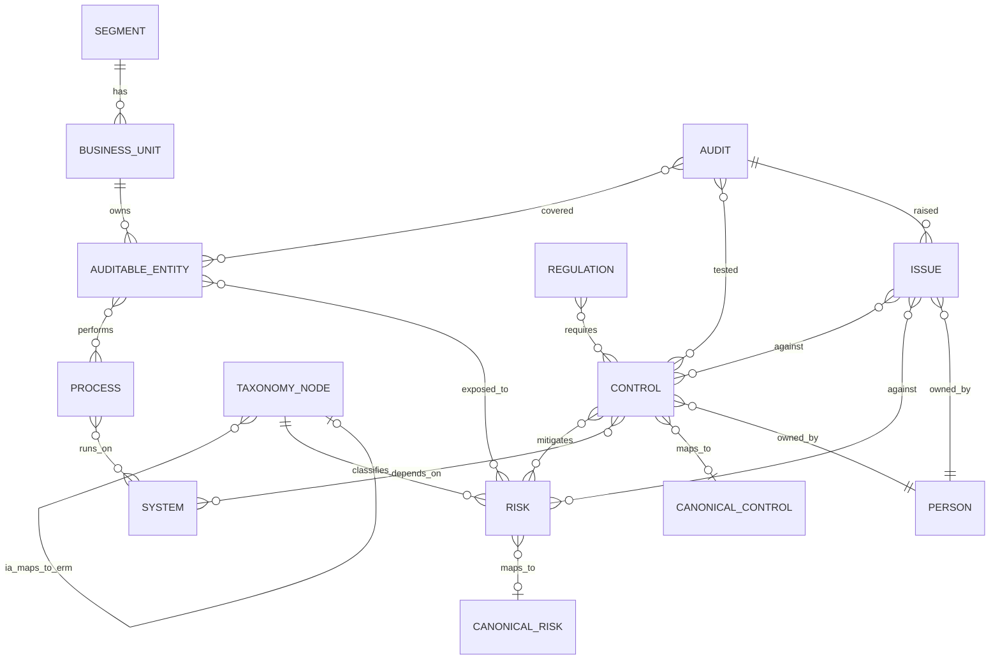

# Data model

The schema (`src/features/stores/schema.sql` and the Neo4j loader, once built) is the source of truth for fields. This file holds what the schema cannot say on its own. Drafted in the kickoff interview, 2026-11-19.

## The institution
A fictional US regional bank, about $60B in assets. Segments: Consumer Banking, Commercial Banking, Wealth Management, Treasury & Markets, Operations, Technology, Corporate functions. All names (institution, people, vendors, systems) come from fictional name lists the project controls.

## Entities and relationships

Notes:
- **Two sources.** `TAXONOMY_NODE`, `RISK` and `CONTROL` each carry `source` = `ERM` or `IA`. ERM's taxonomy is Basel-style (L1: Credit, Market, Liquidity, Operational, Compliance, Strategic, Reputational); IA's is a legacy L1-L3 that maps unevenly onto it.
- **Risk levels.** L1-L3 are taxonomy categories (a tree per source). A risk is an L4 item under exactly one L3 node of its own source's tree.
- **Controls.** ERM controls come from the RCSA; IA controls from the RCMs. Attributes: type (preventive/detective), nature (manual/automated), frequency, key flag, owner.
- **Canonical layer.** Output of reconciliation. ERM's taxonomy is the common framework: IA taxonomy nodes map onto ERM nodes, and source risks and controls map to canonical items. Matches below the confidence threshold sit in a review queue instead.
- **Issue sources.** IA, Regulator (MRA/MRIA), self-identified, 2nd line. Only IA issues link to an audit.
- **Answer key.** The generator records which source items are true duplicates and the true taxonomy mapping, in a separate folder. It is used only for scoring.
- **Published layout** (005). ERM and IA are separate systems, so taxonomy nodes, risks and controls are published one file per source (`risk_erm.csv`, `risk_ia.csv`, ...), as is every relationship touching them. Audits test IA controls only. The column-level data dictionary is `src/features/generator/README.md`.
- **Documents (M2).** Workpapers, RCMs and reports, linked to audits, controls and issues. Not in M1.

- **Risk populations at full size** (007). A risk is an instance of a *theme* (a kind of risk, such as fraudulent wire transfers) applied to one auditable entity; 56 themes give 232 instances. The generator picks which instances appear in ERM, in IA, in both (a true match) or twice in ERM (a within-ERM duplicate). IA names its audit area (the entity) in its text; ERM describes the context in its own business terms, and its context phrase never uses a distinctive word of the entity's name; a few ERM risks still name an entity when that name is the risk's own subject (for example Fair Lending, Tax). ERM entries vary in sentence frame and wording by team; a duplicate keeps its original's statement and frame and words the cause differently. Inherent ratings vary by instance around the theme's rating: High 15-35%, Medium 40-60%, Low 15-35% per source.
- **Exposure differs by source** (007). IA links a risk to its specific auditable entity. ERM links it to every entity of the owning business unit, and 10-20% of ERM exposure links point to an entity of another business unit in the same segment (a stale register).
- **Risk answer key** (`answer_key/risk_clusters.csv`: `source`, `risk_id`, `cluster_id`, `true_erm_node_id`). Every risk appears once; a cluster with both sources is a true match; two ERM risks in one cluster are a duplicate; `none` means unmatched. Every risk, ERM or IA, carries its true ERM L3 node. An IA risk is *misfiled* when its true ERM node is not under its IA node's mapped ERM target, including when that IA node is unmapped (10-20% of IA risks).
- **Control populations at full size** (008). Each risk instance has its theme's *specific* control in each source holding it. *Generic* controls come from eight kinds (policy and procedures, management oversight, exception monitoring, reconciliation, segregation of duties, staff training, access restriction, key risk indicator). ERM records generic controls bank-wide, one per theme and kind, mitigating every ERM risk of the theme; IA records them per risk instance, taking ERM's kinds for the theme with probability 0.6 (the overlap dial) and otherwise from the same weighted mix. ERM and IA word subjects and kind labels differently; IA's detailed text cites the enterprise control it implements, with IA's own word for the kind and ERM's subject phrase ("enterprise oversight standard on outgoing wire transfers"). This is a deliberate, realistic cue (owner decision, 2026-11-20): real IA work papers cite enterprise policies by name. Measured on seed 42: quoting ERM's whole title inside IA text pairs generic controls at F1 0.30; matching ERM's subject phrase plus control type reaches F1 0.64, and adding a hand-made map from IA's kind words to ERM's labels reaches 0.78. E2 should report how much of its control accuracy comes from this cue. Owners always differ within a match; IA records a neighbouring frequency for about 22% of its controls; control type always agrees. ERM names systems for about half its controls; only specific, reconciliation and access-restriction controls depend on systems.
- **Control answer key** (`answer_key/control_clusters.csv`: `source`, `control_id`, `cluster_id`). A cluster is one ERM control plus every IA control of the same risk instance (specific) or the same theme and kind (generic); no cluster holds two ERM controls. Orphan controls (3-6% per source) mitigate no risk, sit in no cluster and have no counterpart in the other source (the build refuses one that does). Note for E2: "mitigates no risk" always predicts "unmatched"; that is a small, honest structural give-away, not matcher skill. Only cross-source pairs (and ERM duplicates) are scored; several IA controls documenting one enterprise control share wording by design.
- **Scenarios** (`answer_key/scenarios.csv`: `scenario`, `item_id`). Child d writes `shared_system`: the 3 systems whose dependent controls reach the most auditable entities through control -> mitigates -> risk -> exposed entity, as the union over both sources (ties by system name; the third must beat the fourth outright). Child e appends its scenarios.
- **Audit plan at full size** (009). About 75 audits, 25 a year (2023-2025), each covering 1-3 auditable entities chosen by risk (entities with High IA risks are sampled more often); about 10% of entities with IA risk sit outside the plan, and random sampling leaves others unaudited (10-30% in all). An audit scopes in about two thirds of each covered entity's IA risks and tests every IA control (specific and generic) mitigating them; a risk counts as tested when any of its IA controls was tested.
- **Issues at full size** (009). About 250: IA 50% (raised by audits, against a tested control and the risk it mitigates, opened up to 20 days after the audit ends), regulator 15%, self-identified 15%, 2nd line 20% (against an ERM control and the ERM risk it mitigates). Titles use four phrasings per source on the source's own subject wording, never the control's title; descriptions open four ways around the control's finding. The finding sentence recurs across issues on one control: a realistic cue (the same root cause), documented, not hidden. Measured on seed 42: stripping the four fixed openings and grouping by the remaining finding puts every planted repeat group in one bucket (recall 1.0, pair precision about 0.5, since findings are shared per theme). An IA issue opens within its audit's year.
- **Planted scenarios** (009, appended to `answer_key/scenarios.csv` after 008's `shared_system`): `repeat_finding:<n>` lists every IA issue against one IA control that failed in at least two years (pairwise different titles); the listed groups are all such controls (no unlisted repeats); `untested_high_risk` lists exactly the High-rated IA risks none of whose IA controls any audit tested; `rising_category` names the ERM L1 node whose regulator, self-identified and 2nd-line issues (classified through the published ERM taxonomy, no answer key) rise at least 50% from 2023 to 2025 from at least 8, while total issues stay within 15%. IA issues are not counted for the rising category (E3 round 7). Every regulation reaches at least one business unit at full size.
- **Stale coverage** (for E3 round 2): a control is stale when never tested in the window, or last tested more than 24 months before window end.
- **Default size.** `python -m akg build` builds full size; `--size sample` builds the sample pack's slice. Full size uses templated text until E1 child f.
Target sizes: ERM about 180 risks and 300 controls; IA about 150 risks and 400 controls; about 60% overlap between the populations. About 80 auditable entities, 75 audits over 3 years, 250 issues, 120 people, 30 systems, 15 regulations. Built-in messiness: duplicates inside ERM, controls described at different levels of detail, orphan controls that mitigate no risk.

## Invariants
Rules that must always hold. Each has an ID and a test that enforces it (tests named once the code exists).

| ID | Invariant | Enforced by |
|---|---|---|
| INV-1 | Each taxonomy is a strict tree; every L4 risk sits under exactly one L3 node of its own source's taxonomy. | Taxonomy part: `generator.test_invariants.InvariantTests.test_ac2_inv1_taxonomies_are_strict_trees`; risk part: `generator.test_invariants.InvariantTests.test_ac2_inv1_each_risk_under_one_l3_of_its_source` |
| INV-2 | Every auditable entity belongs to exactly one business unit. | `generator.test_invariants.InvariantTests.test_ac3_inv2_each_entity_has_exactly_one_owner` |
| INV-3 | Each source risk or control maps to at most one canonical item, or is in the review queue; nothing below the confidence threshold is merged silently. | TBD (E2) |
| INV-4 | Every IA issue links to exactly one audit; every issue links to at least one control or risk, and has exactly one owner and one source. | `generator.test_invariants.InvariantTests.test_ac2_inv4_inv5_issue_links_and_dates` |
| INV-5 | Dates are consistent: closure never before open; audits within the 3-year window; an issue never before the audit that raised it. | `generator.test_invariants.InvariantTests.test_ac2_inv4_inv5_issue_links_and_dates` |
| INV-6 | The reconciliation pipeline never reads the answer key; it is used only for scoring. | TBD (E2) |
| INV-7 | The same seed produces byte-identical output. | Sample: `generator.test_determinism.DeterminismTests.test_ac3_inv7_output_matches_golden_checksums`; full: `generator.test_determinism.DeterminismTests.test_ac5_full_build_matches_full_golden` |
| INV-8 | SQLite and Neo4j hold the same facts (row counts reconcile with node and edge counts). | TBD (E3) |
| INV-9 | Institution, people, vendor and system names come only from the project's fictional name lists. | `generator.test_names.NameTests.test_ac4_inv9_names_from_lists_and_no_denied_name_anywhere` |
| INV-10 | No relationship crosses sources: ERM controls mitigate ERM risks, IA controls IA risks, each taxonomy is its own tree, and so on. ERM-IA links exist only in the answer key (truth) and the canonical layer (E2 output). | `generator.test_referential.ReferentialTests.test_ac12_relationship_ids_exist_and_never_cross_sources` |

## Decisions
- **ERM's taxonomy is the common framework** (kickoff, 2026-11-19): it is what most banks actually do, and it is easier to defend than inventing a new one.
- **Everything is synthetic, public and regenerable**, so there are no retention or deletion concerns. The answer key is published too, for transparency.

## Open data questions
- Matching method for reconciliation (research R1).
- Templated vs AI-written descriptions (research R2).
